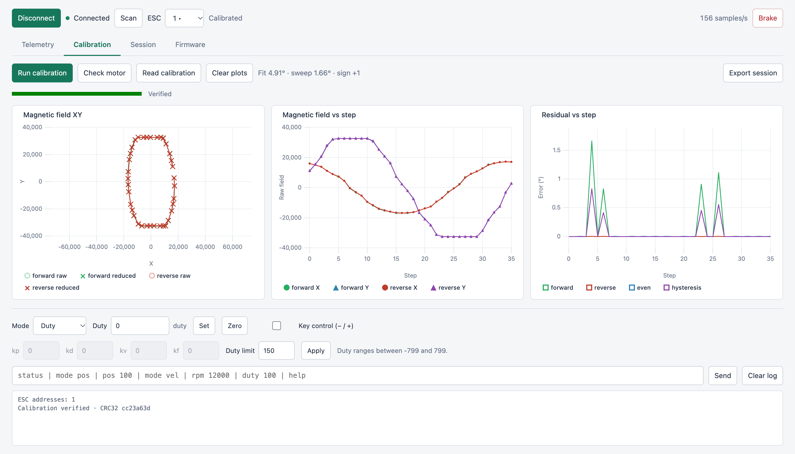

# penny-gui

[Open penny-gui](https://qwertpas.github.io/pennyesc/)

Browser control, calibration, live position and velocity plots, and firmware flashing for PennyESC.

Open in your browser. Choose **USB** or **BLE**, connect, and select the ESC address. BLE supports controls, Aux PWM, and 200 samples/s telemetry. USB takes priority and is required for firmware flashing, pin changes, and calibration. Use the controls or commands to set duty, position, and velocity. Enable **Key control** to hold `−` or `+` for signed duty; release to stop.

Use **Aux** for 200 Hz servo PWM (1000–2000 µs), default GPIO 11. Enable **Key control (1–9)** to select pulses in 125 µs steps from any view. The setting stays enabled across view and window switches. Bridge defaults: ESP32S3 SuperMini, RX 12, TX 13, GND.
