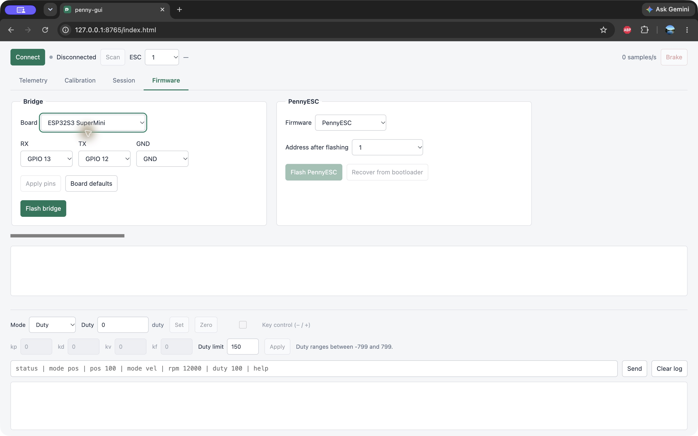

# PennyESC firmware

PennyESC communicates over UART. For calibration and configuration, I use an ESP32S3 SuperMini dev board as a USB-to-UART bridge between the computer and the ESC. The bridge lets Penny GUI send motor commands, read feedback, and flash firmware over UART. For your own implementation, any microcontroller with UART would work, see the Arduino API reference below.

## Hardware connections
| PennyESC | Connect to |
| --- | --- |
| GND | Power supply ground and bridge ground |
| UART RX | Bridge TX |
| UART TX | Bridge RX, with a pull-up to 3.3 V |
| Power | 5–15 V supply |

Multiple ESCs can share the UART bus, but each needs a unique address. Connect the ESP32 to your computer with USB. Penny GUI lets you configure the bridge's RX, TX and ground pins in the Firmware tab.

## Flashing

The first time you use an ESC, you must seed it over ST-Link. Seeding installs the bootloader and application. After that, the bridge handles firmware updates and address changes over UART without ST-Link.

Run these commands from the repository root with PlatformIO installed. Close the GUI and any serial monitor first. Only one process can use the serial port or ST-Link at a time.

### 1. Flash the bridge

Upload the bridge firmware to the ESP32S3 SuperMini:

```sh
pio run -d firmware/esp32s3demo -e bootbridge -t upload
```

### 2. Seed the ESC over ST-Link

Connect ST-Link SWDIO, SWCLK and GND to the matching ESC pads, and power the ESC. This installs the bootloader and application at address 1. 

```sh
ESC_ADDRESS=1 pio run -d firmware/pennyesc_libopencm3 -e seed -t seed_upload
```

### 3. Update the ESC over UART

Connect the seeded ESC to the bridge. Set `ESC_ADDRESS` to the board's current address.

```sh
ESC_ADDRESS=1 pio run -d firmware/pennyesc_libopencm3 -e pennyesc_uart -t uart_upload
```

The tools detect the bridge port automatically. To select one, add `BRIDGE_PORT=/dev/cu.usbmodemPORT` before `pio`.

If an update stops partway, power-cycle the ESC and run the recover target. It waits for the ESC's bootloader, which listens for about a second after power-up:

```sh
ESC_ADDRESS=1 pio run -d firmware/pennyesc_libopencm3 -e pennyesc_uart -t uart_recover
```

### 4. Change the ESC address over UART

This reflashes the application with the new address. Use the new address for later commands.

```sh
CURRENT_ESC_ADDRESS=1 NEW_ESC_ADDRESS=2 pio run -d firmware/pennyesc_libopencm3 -e readdress -t uart_readdress
```

## Bridge protocol

The bridge has no modes and no text commands. Each message is a packet of a type byte, a payload and a CRC-8, COBS encoded between `0x00` bytes on USB, or one GATT write or notification on BLE. A UART packet names the baud for its bytes: 921600 for ESC frames, 115200 for the ESC bootloader. Unplugging, resetting or reconnecting either side in any order never leaves the bridge in a state the host has to undo. [pennyesc_bridge.h](Lib/pennyesc_bridge.h) defines the packets, and [pnybridge.py](tools/pnybridge.py) is a Python client.

## Penny GUI

Open [Penny GUI](https://qwertpsa.github.io/pennyesc) in your browser. Use it to configure bridge pins, update firmware, calibrate and test motors. Calibration persists across power cycles.



## Arduino API reference

Include [pennyesc_arduino.h](Lib/pennyesc_arduino.h) in your ESP32 Arduino project to control an ESC directly from your code:

```cpp
#include "pennyesc_arduino.h"

PennyEsc esc(1);

void setup() {
  esc.begin(Serial1, 13, 12); // RX, TX GPIOs
}

void loop() {
  esc.setDuty(100);
  delay(1000);
  esc.brake();
  delay(1000);
}
```

### Motor commands and feedback

| Call | Use |
| --- | --- |
| `esc.begin(serial, rx, tx)` | Start UART at 921600 baud. |
| `esc.address()` / `esc.setAddress(address)` | Read or select the address used by this client. Does not change the ESC's address. |
| `esc.getStatus(status)` | Read a `PennyEscStatus` with motor state, sensor data and fault counters. |
| `esc.getPosVel(data)` | Read position and velocity into `PennyEscEncoderData`. |
| `esc.requestPosVel()` | Request position and velocity without waiting for a reply. |
| `esc.readPosVelAvailable(data)` | Read a pending encoder reply without blocking. Returns false if none is ready. |
| `esc.setDuty(duty)` / `esc.sendDuty(duty)` | Set duty, from -799 to 799. `sendDuty` requests no reply. |
| `esc.brake()` | Brake the motor. |
| `esc.zeroPosition()` | Set the current position as zero. |
| `esc.setPositionRad(rad)` / `esc.sendPositionRad(rad)` | Set an absolute target relative to zero. `sendPositionRad` requests no reply. |
| `esc.setPositionTurn32(position)` / `esc.sendPositionTurn32(position)` | Set a target in raw units, with 65536 per revolution. |
| `esc.setControl(kp, kd, kv, kf, clip)` | Set position gain, velocity damping, velocity feedforward, duty feedforward and duty limit. |
| `esc.setAdvanceDeg(degrees)` | Set electrical commutation advance. |
| `esc.enterBootloader()` | Enter the UART bootloader for an update. |
