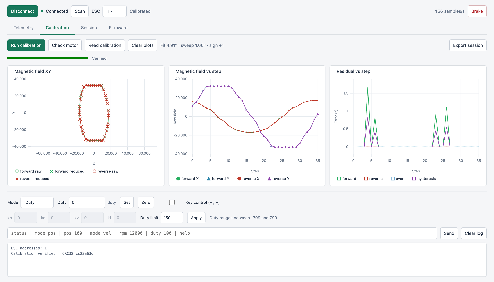

# PennyESC

[Open penny-gui](https://qwertpas.github.io/pennyesc/)

Browser control, calibration, live position and velocity plots, and firmware flashing for PennyESC.

Open in your browser. Use **Firmware** to install the bridge firmware and choose RX, TX, and GND pins. Connect USB, select the ESC address, and run calibration. Use the controls or commands to set duty, position, and velocity. Enable **Key control** to hold `−` or `+` for signed duty; release to stop.

Connect bridge RX to ESC TX, bridge TX to ESC RX, and share GND. Power the ESC separately. ESC TX needs a pull-up to 3.3 V.
